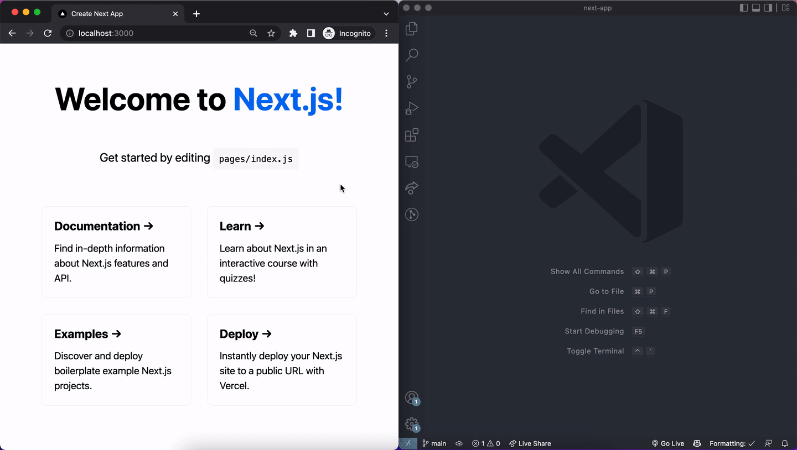
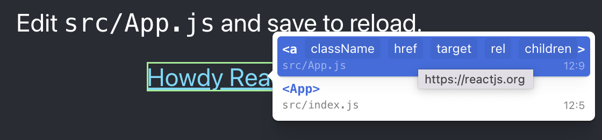
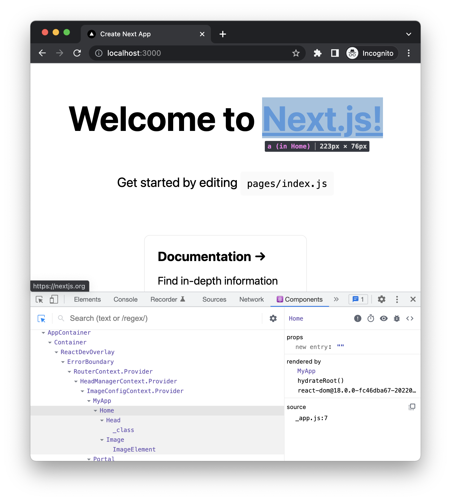

# <ClickToComponent />

[](https://www.npmjs.com/package/click-to-react-component)
[](https://github.com/ericclemmons/click-to-component/actions/workflows/release.yml)

<kbd>Option+Click</kbd> a Component in the browser to **instantly** goto the source in your editor.



## Features

- <kbd>Option+Click</kbd> opens the immediate Component's source
- <kbd>Option+Right-click</kbd> opens a context menu with the parent Components' `props`, `fileName`, `columnNumber`, and `lineNumber`

  > 

- Works with frameworks like [Next.js](https://nextjs.org/),
  [Create React App](https://create-react-app.dev/),
  & [Vite](https://github.com/vitejs/vite/tree/main/packages/plugin-react)
  that use [@babel/plugin-transform-react-jsx-source](https://github.com/babel/babel/tree/master/packages/babel-plugin-transform-react-jsx-source)
- Supports `vscode` & `vscode-insiders` & `cursor` [URL handling](https://code.visualstudio.com/docs/editor/command-line#_opening-vs-code-with-urls)
- Automatically **tree-shaken** from `production` builds
- Keyboard navigation in context menu (e.g. <kbd>←</kbd>, <kbd>→</kbd>, <kbd>⏎</kbd>)
- Inspect a development page through a [DevTools Snippet](#browser-snippet), with
  automatic selection and a movable panel for status, pause/resume and cleanup.
- More context & faster than using React DevTools:

  > 

## Installation

<details>
<summary>npm</summary>

```shell
npm install click-to-react-component
```

</details>

<details>
<summary>pnpm</summary>

```shell
pnpm add click-to-react-component
```

</details>

<details>
<summary>yarn</summary>

```shell
yarn add click-to-react-component
```

</details>

Even though `click-to-react-component` is added to `dependencies`, [tree-shaking](https://esbuild.github.io/api/#tree-shaking) will remove `click-to-react-component` from `production` builds.

## Usage

<details>
<summary>Create React App</summary>

[/src/index.js](https://github.com/ericclemmons/click-to-component/blob/main/apps/cra/src/index.js#L11)

```diff
+import { ClickToComponent } from 'click-to-react-component';
 import React from 'react';
 import ReactDOM from 'react-dom/client';
 import './index.css';
@@ -8,7 +7,6 @@ import reportWebVitals from './reportWebVitals';
 const root = ReactDOM.createRoot(document.getElementById('root'));
 root.render(
   <React.StrictMode>
+    <ClickToComponent />
     <App />
   </React.StrictMode>
 );
```

> 

</details>

<details>
<summary>Next.js</summary>

[pages/\_app.tsx](https://github.com/ericclemmons/click-to-component/blob/main/apps/next/pages/_app.tsx#L8)

```diff
+import { ClickToComponent } from 'click-to-react-component'
 import type { AppProps } from 'next/app'
 import '../styles/globals.css'

 function MyApp({ Component, pageProps }: AppProps) {
   return (
     <>
+      <ClickToComponent />
       <Component {...pageProps} />
     </>
   )
```

> 

</details>

<details>
<summary>Vite</summary>

```diff
+import { ClickToComponent } from "click-to-react-component";
import React from "react";
import ReactDOM from "react-dom/client";
import App from "./App";
import "./index.css";

ReactDOM.createRoot(document.getElementById("root")!).render(
  <React.StrictMode>
    <App />
+   <ClickToComponent />
  </React.StrictMode>
);
```

> 

</details>

<details>
<summary>Docusaurus</summary>

    npm install @babel/plugin-transform-react-jsx-source

babel.config.js:

```js
module.exports = {
  presets: [require.resolve('@docusaurus/core/lib/babel/preset')],
  plugins: [
    ...(process.env.BABEL_ENV === 'development'
      ? ['@babel/plugin-transform-react-jsx-source']
      : []),
  ],
};
```

src/theme/Root.js:

```js
import { ClickToComponent } from 'click-to-react-component';
import React from 'react';

// Default implementation, that you can customize
export default function Root({ children }) {
  return (
    <>
      <ClickToComponent />
      {children}
    </>
  );
}
```

</details>

If [developing in container](https://github.com/ericclemmons/click-to-component/issues/58)?

### `editor`

By default, clicking will default `editor` to [`vscode`](https://code.visualstudio.com/).

If, like me, you use [`vscode-insiders`](https://code.visualstudio.com/insiders/), you can set `editor` explicitly:

```diff
-<ClickToComponent />
+<ClickToComponent editor="vscode-insiders" />
```

## Browser Snippet

Load the inspector into an existing React development page without adding a
dependency to that application or editing its source.

### Build and load

From this repository's root, using Node.js 18 or later:

```shell
pnpm install
pnpm --filter click-to-react-component build:browser
```

The command generates `packages/click-to-react-component/dist/click-to-component.js`.
The bundle includes its own React 18 renderer and does not replace the target
application's React instance. The React and ReactDOM development dependencies
support this build; they do not upgrade the target application.

1. Open the target development page and its browser DevTools.
2. In **Sources > Snippets**, create a new Snippet.
3. Copy the **entire generated file** into it and run it with **Ctrl+Enter**
   (**Command+Enter** on macOS).
4. Look for the **Source inspector** panel and its **Inspector loaded** message.

The inspector starts in selection mode. Saving or pasting a Snippet alone does
not execute it. Run the Snippet in the execution context of the page you want to
inspect; for iframe content, choose that frame's context.

### Select and control

- Move over a page element to highlight it, then click to open its source.
- Right-click an element to choose from its React component owners.
- Use **Pause selection** to restore normal page interaction and **Resume
  selection** to start inspecting again.
- Drag the panel's title to move it. Its position stays within the viewport,
  including after resizing the browser window.
- Use **Close** to remove the panel, component menu, highlight markers and tool
  event listeners.

The panel uses Shadow DOM to isolate its styles. Its controls and component
menu are excluded from selection. The regular embedded component continues to
use Alt/Option by default; the Snippet enables selection automatically.

Running the Snippet again replaces the previous inspector. Refreshing the page
removes it. After changing the inspector source, rebuild and replace the saved
Snippet's contents before running it again; saved Snippets do not update
automatically. The generated `dist` directory is ignored by Git.

### Configure the editor and paths

Set options in the page's Console before running the Snippet:

```js
window.__CTC_OPTIONS__ = {
  editor: 'cursor',
  pathModifier: (path) =>
    path.replace('/workspace/project/', 'D:/my-project/'),
}
```

`editor` defaults to `vscode`. The modifier receives the complete path, including
its trailing `:line:column`; preserve that location in the returned value. Rerun
the Snippet after changing options.

To remove the inspector from the Console:

```js
window.__CTC__?.unmount()
```

### Requirements and troubleshooting

Source navigation requires React development source metadata (`_debugSource`)
and an editor URL handler installed on the local machine. This change does not
add React 19 debug-stack or source-map resolution. The standalone bundle retains
development code, but it cannot restore source metadata missing from a target
page or production build.

If the panel is missing, check that the Snippet ran successfully in the correct
frame and inspect the Console for errors. `Boolean(window.__CTC__)` indicates
whether the inspector control object is available. If highlighting works but a
source cannot be opened, read the panel's status message and check the page's
source metadata, local paths and editor URL handler.

Avoid loading the Snippet alongside an embedded `<ClickToComponent />` in the
same page, since both integrations would register selection handlers. The
repository's existing example applications already embed the component.

### Component integration options

The browser entry reuses the existing component with these additional optional
props, also available to applications embedding it directly:

| Prop | Default | Purpose |
| --- | --- | --- |
| `active` | `false` | Keep selection enabled without holding Alt/Option. |
| `onStatus` | — | Receive source-navigation and missing-metadata messages. |
| `portalId` | Floating UI's default | Place the component menu in a dedicated container. |

## Run Locally

Clone the project

```shell
gh repo clone ericclemmons/click-to-component
```

Go to the project directory

```shell
cd click-to-component
```

Install dependencies

```shell
pnpm install
```

Run one of the examples:

<details>
<summary>Create React App</summary>

```shell
cd apps/cra
pnpm start
```

</details>

<details>
<summary>Next.js</summary>

```shell
cd apps/next
pnpm dev
```

</details>
